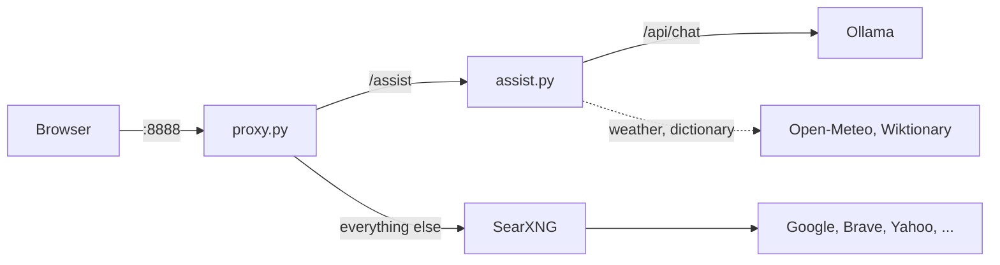

<p align="center"></p>

<h1 align="center">DuckDuckXNG</h1>

<p align="center">
  <a href="https://github.com/searxng/searxng">SearXNG</a> with a DuckDuckGo-style look and a local AI Search Assist.<br>
  No tracking, no API keys, no cloud AI: answers come from an <a href="https://ollama.com">Ollama</a> model on your own machine.
</p>

<p align="center">
  <a href="#quick-start">Quick start</a> ·
  <a href="#configuration">Configuration</a> ·
  <a href="#search-assist">Search Assist</a> ·
  <a href="#troubleshooting">Troubleshooting</a>
</p>

---

## Contents

- [Features](#features)
- [Quick start](#quick-start)
- [Using a GPU](#using-a-gpu)
- [How it works](#how-it-works)
- [Configuration](#configuration)
  - [`.env`](#env)
  - [Backends](#backends)
  - [Models](#models)
  - [Exposing it](#exposing-it)
  - [Search engines](#search-engines)
  - [Ports](#ports)
- [Search Assist](#search-assist)
  - [The style](#the-style)
  - [Changing it](#changing-it)
  - [API](#api)
- [Troubleshooting](#troubleshooting)
- [Updating](#updating)
- [Files](#files)
- [Privacy](#privacy)
- [License](#license)

## Features

| Feature | What you get |
|---|---|
| **DuckDuckGo-style layout** | results with site names, filter menus, image grid, videos carousel, related searches, settings page |
| **Search Assist** | a 2-sentence answer above the results, streamed from a local model, with Explore More follow-up questions |
| **AI Chat** | full-page chat with the same model; chats are saved in your browser |
| **Instant answers** | calculator, unit and currency converter, weather, dictionary, timer, stopwatch, time, colour picker, password and random number |
| **Bangs** | `!w rambutan`, `!gh searxng` and the rest, the same as DuckDuckGo |

## Quick start

You need Docker with Compose, about 6 GB of disk space, and ideally a GPU with 8 GB of VRAM. CPU-only works too: see [Models](#models).

```sh
git clone https://github.com/owainxyz/DuckDuckXNG
cd DuckDuckXNG
cp .env.example .env
sed -i "s/^SEARXNG_SECRET=.*/SEARXNG_SECRET=$(openssl rand -hex 32)/" .env
docker compose up -d
docker exec duckduckxng-ollama ollama pull qwen2.5:7b
```

Open **http://127.0.0.1:8888**.

> [!NOTE]
> Everything binds to `127.0.0.1`. To use it from other devices, see [Exposing it](#exposing-it).

## Using a GPU

With an NVIDIA card and [nvidia-container-toolkit](https://docs.nvidia.com/datacenter/cloud-native/container-toolkit/latest/install-guide.html) installed, uncomment the `deploy` block under `ollama` in `compose.yml`, then:

```sh
docker compose up -d
```

If Ollama is already running on another machine, skip the `ollama` container and point `BACKENDS` at it. See [Backends](#backends).

## How it works



- **SearXNG** is the stock image. On every start its entrypoint appends `ddg.css` and `assist.js` to SearXNG's own bundles, so image updates keep working.
- **assist.py** builds the Search Assist prompt from the top 4 results and streams the model's answer back. It caches answers for 24 hours and cancels an answer when you search again.
- **proxy.py** serves both on one port, so the page can call `/assist` without CORS.

---

## Configuration

### `.env`

| variable | default | what it does |
|---|---|---|
| `SEARXNG_SECRET` | none, required | SearXNG's secret key. Generate one with `openssl rand -hex 32`. |
| `PORT` | `8888` | port the site is served on |
| `BASE_URL` | `http://127.0.0.1:8888/` | the URL people open; set it to your public URL if you put a proxy in front |
| `BACKENDS` | `http://127.0.0.1:11434=qwen2.5:7b` | which Ollama servers and models Search Assist uses (see [Backends](#backends)) |

Apply changes with `docker compose up -d`.

### Backends

`BACKENDS` is a comma-separated list of `url=model`, tried in order. If a backend can't be reached, it's skipped for 30 seconds and the next one is used.

```sh
# one GPU machine
BACKENDS=http://127.0.0.1:11434=qwen2.5:7b

# a gaming PC first, falling back to a small model on the server's CPU
BACKENDS=http://192.168.1.20:11434=qwen2.5:7b,http://127.0.0.1:11434=qwen2.5:0.5b-instruct-q4_0=small
```

Add `=small` to a CPU-only backend. It then gets a short prompt, a 512-token context and 2 threads, so it can answer in 10–15 s on a weak CPU. A `small` backend is never skipped.

To use Ollama on another machine, run it with `OLLAMA_HOST=0.0.0.0`, and make sure the search server can reach port 11434 on it. Set these on that machine too:

```sh
OLLAMA_KEEP_ALIVE=-1
OLLAMA_CONTEXT_LENGTH=8192
```

Without them, the model unloads after 5 minutes and has to reload during a search. See [Searching freezes my PC](#searching-freezes-my-pc-for-a-few-seconds).

### Models

| hardware | model | VRAM / RAM | answer time | quality |
|---|---|---|---|---|
| 8 GB GPU | `qwen2.5:7b` | ~5 GB | ~1.5 s | good |
| 4–6 GB GPU | `qwen2.5:3b` | ~2.4 GB | ~1 s | ignores some style rules |
| CPU only | `qwen2.5:0.5b-instruct-q4_0` | ~0.5 GB | 10–15 s | short and basic |

Pull a model with:

```sh
docker exec duckduckxng-ollama ollama pull <model>
```

On CPUs without AVX, `q4_0` builds run several times faster than the default `q4_K_M`.

### Exposing it

Everything listens on `127.0.0.1` only. Put a reverse proxy in front of port 8888 and set `BASE_URL` to the public address.

**Caddy**

```caddy
search.example.com {
    reverse_proxy 127.0.0.1:8888
}
```

**Tailscale** (private to your tailnet)

```sh
tailscale serve --bg --https=443 http://127.0.0.1:8888
```

> [!WARNING]
> SearXNG's rate limiter is off in `settings.yml`, and Search Assist runs a model for every search. If you open it to the internet, turn the limiter on (`server.limiter: true`, which needs Valkey/Redis) or put authentication in front.

### Search engines

Engines are set in [`searxng/settings.yml`](searxng/settings.yml). The defaults are tuned for speed:

- Google, Brave and Yahoo are on.
- Engines that are slow or often CAPTCHA'd are off: Bing, Startpage, Qwant, Mojeek and Wikidata.
- `request_timeout` is 1.5 s with a 2.5 s maximum.

`hostnames` raises sites such as Wikipedia, Stack Overflow, GitHub and MDN, lowers content farms, and removes Pinterest and Quora. Edit those lists to suit yourself.

See the [SearXNG settings docs](https://docs.searxng.org/admin/settings/index.html) for everything else.

### Ports

Everything runs on the host network:

| port | service |
|---|---|
| 8888 | `proxy.py`, the one you open |
| 7500 | SearXNG |
| 7501 | `assist.py` |
| 11434 | Ollama |

If 7500 or 7501 is taken, change `SEARXNG_PORT` / `GRANIAN_PORT` in `compose.yml` and `server.port` in `settings.yml` for SearXNG, or set `PORT`, `ASSIST_PORT` and `SEARXNG_PORT` in the `assist` service.

---

## Search Assist

Search Assist writes a short answer above the results, in the same style as DuckDuckGo's:

> **Rambutan** is a fruit native to Southeast Asia with a red, spiky outer shell and sweet, juicy white flesh. It is often eaten by popping off the shell and sucking out the flesh.

It runs on the first page of **All** results. Turn it off with the Search Assist toggle next to the gear icon (saved in your browser).

How an answer is made:

1. The page sends the query and the top 4 results (title + snippet) to `/assist`.
2. `assist.py` builds the prompt: the style rules, six worked examples, then the query and results.
3. The model's reply streams back word by word. The server stops it after two sentences.
4. The answer is cached for 24 hours. If you search again before it finishes, it's cancelled.

**More** under the answer asks the model for a longer write-up. **Explore More** shows three follow-up questions, taken from SearXNG's suggestions, and answers each one when you open it.

### The style

DuckDuckGo's answers follow a clear pattern, and the prompt copies it:

| query type | first sentence | second sentence |
|---|---|---|
| a thing (`salak`) | *X is a …* with its key facts | origin, taste, use |
| best X (`best budget gpu`) | the single best pick and why | a second option |
| how-to (`how to cook rice`) | the method, with the numbers | a tip |
| yes/no (`is coffee bad for you`) | the verdict | the caveat |
| a list (`snacks for a road trip`) | *X include a, b, c and d.* | one detail |

Other rules:
- It bolds one thing at most.
- It never starts with "Try".
- It never names websites.
- It never says "according to the search results".
- It uses its own knowledge as well as the results, so it still answers when the snippets are thin.

### Changing it

Everything is at the top of [`assist/assist.py`](assist/assist.py):

| name | what |
|---|---|
| `big["answer"]` | the style rules and token limit for GPU backends |
| `SHOTS` | the worked examples. The model copies their length and tone more than it follows the rules. |
| `big["questions"]` | the prompt for Explore More questions, used when SearXNG has no suggestions |
| `local_prompt()` | the much shorter prompt for `=small` CPU backends |
| `TWO` | the regex that cuts answers off after two sentences |
| `chat_system` | the AI Chat personality |

Restart after editing:

```sh
docker compose restart assist
```

> [!TIP]
> Don't make an example too close to a query people will really search for. A 7B model will copy names straight out of it. An example about "exotic vegetables" got kohlrabi into answers about fruit.

### API

`assist.py` listens on `127.0.0.1:7501` and is served at `/assist` through the proxy.

**POST `/assist`**: streams plain text.

```json
{"q": "rambutan", "mode": "answer", "results": [{"title": "...", "content": "...", "url": "..."}]}
```

| `mode` | needs | returns |
|---|---|---|
| `answer` | `q`, `results` | the 2-sentence answer |
| `questions` | `q`, `results` | 3 follow-up questions, one per line |
| `chat` | `messages` (`[{role, content}]`, last one from the user) | the chat reply. The `X-Model` header names the model. |

**GET `/assist?ia=weather&q=<place>`**: current weather and a 7-day forecast from Open-Meteo (JSON).

**GET `/assist?ia=define&q=<word>`**: definitions from Wiktionary (JSON).

---

## Troubleshooting

Start with the logs:

```sh
docker compose logs -f assist searxng
```

### Search Assist never appears

- **No model pulled.** Run `docker exec duckduckxng-ollama ollama list`. If it's empty, pull the model named in `BACKENDS`.
- **Wrong model name.** The name in `BACKENDS` must match `ollama list` exactly, tag included (`qwen2.5:7b`, not `qwen2.5`).
- **Backend can't be reached.** From the server, run `curl http://<host>:11434/api/version`. A backend that fails the check is skipped for 30 s.
- **It's off.** It only runs on the first page of **All**, and it can be turned off with the toggle by the gear icon.

### Searching freezes my PC for a few seconds

Ollama is loading the model onto the GPU in the middle of a search. A cold load can take 10–20 s and stall the desktop while it does. Two things cause it:

- **The model unloaded.** Set `OLLAMA_KEEP_ALIVE=-1` on the machine running Ollama. The bundled container already has it.
- **A different context size.** Ollama reloads the model whenever `num_ctx` changes. `assist.py` always asks for 8192, so set `OLLAMA_CONTEXT_LENGTH=8192` on Ollama, and don't point other apps at the same model with another size.

Check that the model stays loaded:

```sh
ollama ps   # UNTIL should say "Forever"
```

### Answers are slow

- Check `ollama ps`. `PROCESSOR` should say `100% GPU`. Anything with `CPU` means the model doesn't fit in VRAM: pick a smaller one.
- The first answer after a restart includes loading the model.
- CPU-only backends take 10–15 s with `qwen2.5:0.5b-instruct-q4_0`. Larger models on a CPU are much slower.

### Answers are wrong or ignore the style

Small models struggle with the rules. `qwen2.5:3b` gets facts wrong and bolds everything, and `qwen2.5:7b` is a lot better. See [Models](#models) and [Changing it](#changing-it).

### No results, or few results

SearXNG engines get rate-limited or CAPTCHA'd. Check:

```sh
docker compose logs searxng | grep -i -E "captcha|denied|timeout"
```

Suspended engines come back on their own after a few minutes (`suspended_times` in `settings.yml`). Turning on more engines makes this rarer.

### The theme didn't update

The entrypoint rebuilds the CSS and JS on every start and stamps them with `?v=<time>`. Restart SearXNG, then hard-refresh the page:

```sh
docker compose restart searxng
```

### Port already in use

See [Ports](#ports).

---

## Updating

```sh
git pull
docker compose pull
docker compose up -d
```

## Files

```
compose.yml               SearXNG, Ollama, assist
.env.example              copy to .env
assist/
  assist.py               Search Assist, chat, weather and dictionary API (127.0.0.1:7501)
  proxy.py                one port for SearXNG and /assist
searxng/
  settings.yml            engines, timeouts, hostname priorities
  py/ddgfix.py            SearXNG plugin: DuckDuckGo-style bangs, drops broken links
  theme/ddg.css           the look
  theme/assist.js         Search Assist, chat, instant answers, layout
  theme/ddg/              logo and font
```

## Privacy

- Searches go through SearXNG, so engines see your server, not you.
- Search Assist and chat run on your own Ollama, and nothing is sent to an AI service.
- Weather lookups go to [Open-Meteo](https://open-meteo.com) and definitions to [Wiktionary](https://en.wiktionary.org), from your server.
- Chats, theme and settings are stored in your browser's `localStorage`.

## License

[AGPL-3.0](LICENSE), like SearXNG. Figtree is under the SIL Open Font License ([`Figtree-OFL.txt`](searxng/theme/ddg/Figtree-OFL.txt)).

DuckDuckXNG is not affiliated with or endorsed by DuckDuckGo. DuckDuckGo's own logo and fonts are not included in this repository.
