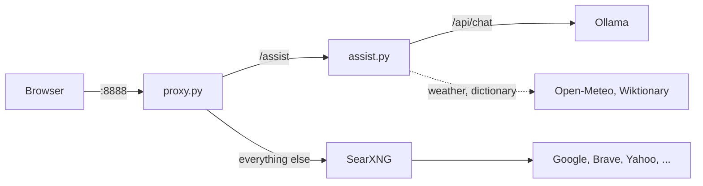

<p align="center"></p>

<h1 align="center">DuckDuckXNG</h1>

<p align="center">
  <a href="https://github.com/searxng/searxng">SearXNG</a> with a DuckDuckGo-style look and a local AI Search Assist.<br>
  No tracking, no API keys, no cloud AI: answers come from an <a href="https://ollama.com">Ollama</a> model on your own machine.
</p>

<p align="center">
  <a href="#quick-start">Quick start</a> ·
  <a href="docs/configuration.md">Configuration</a> ·
  <a href="docs/search-assist.md">Search Assist</a> ·
  <a href="docs/troubleshooting.md">Troubleshooting</a>
</p>

---

## Features

| Feature | What you get |
|---|---|
| **DuckDuckGo-style layout** | results with site names, filter menus, image grid, videos carousel, related searches, settings page |
| **Search Assist** | a 2-sentence answer above the results, streamed from a local model, with Explore More follow-up questions |
| **AI Chat** | full-page chat with the same model; chats are saved in your browser |
| **Instant answers** | calculator, unit and currency converter, weather, dictionary, timer, stopwatch, time, colour picker, password and random number |
| **Bangs** | `!w rambutan`, `!gh searxng` and the rest, the same as DuckDuckGo |

## Quick start

You need Docker with Compose, about 6 GB of disk space, and ideally a GPU with 8 GB of VRAM. CPU-only works too: see [models](docs/configuration.md#models).

```sh
git clone https://github.com/owainxyz/DuckDuckXNG
cd DuckDuckXNG
cp .env.example .env
sed -i "s/^SEARXNG_SECRET=.*/SEARXNG_SECRET=$(openssl rand -hex 32)/" .env
docker compose up -d
docker exec duckduckxng-ollama ollama pull qwen2.5:7b
```

Open **http://127.0.0.1:8888**.

> [!NOTE]
> Everything binds to `127.0.0.1`. To use it from other devices, see [exposing it](docs/configuration.md#exposing-it).

## Using a GPU

With an NVIDIA card and [nvidia-container-toolkit](https://docs.nvidia.com/datacenter/cloud-native/container-toolkit/latest/install-guide.html) installed, uncomment the `deploy` block under `ollama` in `compose.yml`, then:

```sh
docker compose up -d
```

If Ollama is already running on another machine, skip the `ollama` container and point `BACKENDS` at it. See [backends](docs/configuration.md#backends).

## How it works



- **SearXNG** is the stock image. On every start its entrypoint appends `ddg.css` and `assist.js` to SearXNG's own bundles, so image updates keep working.
- **assist.py** builds the Search Assist prompt from the top 4 results and streams the model's answer back. It caches answers for 24 hours and cancels an answer when you search again.
- **proxy.py** serves both on one port, so the page can call `/assist` without CORS.

## Updating

```sh
git pull
docker compose pull
docker compose up -d
```

## Files

```
compose.yml               SearXNG, Ollama, assist
.env.example              copy to .env
assist/
  assist.py               Search Assist, chat, weather and dictionary API (127.0.0.1:7501)
  proxy.py                one port for SearXNG and /assist
searxng/
  settings.yml            engines, timeouts, hostname priorities
  py/ddgfix.py            SearXNG plugin: DuckDuckGo-style bangs, drops broken links
  theme/ddg.css           the look
  theme/assist.js         Search Assist, chat, instant answers, layout
  theme/ddg/              logo and font
```

## Privacy

- Searches go through SearXNG, so engines see your server, not you.
- Search Assist and chat run on your own Ollama, and nothing is sent to an AI service.
- Weather lookups go to [Open-Meteo](https://open-meteo.com) and definitions to [Wiktionary](https://en.wiktionary.org), from your server.
- Chats, theme and settings are stored in your browser's `localStorage`.

## License

[AGPL-3.0](LICENSE), like SearXNG. Figtree is under the SIL Open Font License ([`Figtree-OFL.txt`](searxng/theme/ddg/Figtree-OFL.txt)).

DuckDuckXNG is not affiliated with or endorsed by DuckDuckGo. DuckDuckGo's own logo and fonts are not included in this repository.
